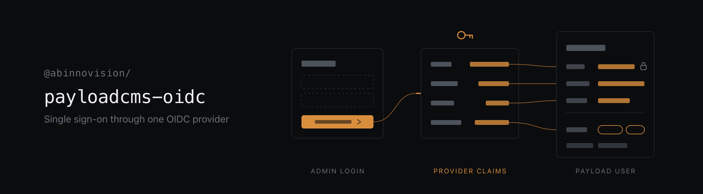

# @abinnovision/payloadcms-oidc



Single sign-on for [Payload CMS](https://payloadcms.com/) through one OpenID Connect provider.

The plugin hands all authentication of one auth collection to your identity provider. Password
login is switched off, users are created and updated from the provider's claims on every
sign-in, roles can be mapped from any claim, and the admin login page forwards straight to the
provider. Beyond the config's `serverURL`, the configuration is three values: issuer,
client ID and client secret.

> [!NOTE]
> Beta, and for Payload 4 only. Releases stay on `0.x` until the API settles, and a minor
> version may include breaking changes. Builds from unreleased changes are published under the
> `beta` npm tag.

## Install

```sh
yarn add @abinnovision/payloadcms-oidc
```

Peer: `payload >=4.0.0-beta.2 <5`. `@payloadcms/ui` and `react ^19` are optional peers, needed only
by the `./admin` entrypoint, which the admin panel loads.

## Setup

```ts
// payload.config.ts
import { oidcPlugin } from "@abinnovision/payloadcms-oidc";
import { buildConfig } from "payload";

export default buildConfig({
  serverURL: "https://cms.example.com",
  // ...
  plugins: [
    oidcPlugin({
      issuer: process.env.OIDC_ISSUER!,
      clientId: process.env.OIDC_CLIENT_ID!,
      clientSecret: process.env.OIDC_CLIENT_SECRET!,
    }),
  ],
});
```

Then run `payload generate:importmap` for the admin components, and `payload generate:types`
for the fields the plugin adds.

At the provider, register a confidential client using the authorization code flow, with these
URIs (`/api` and `/admin` follow your `routes`):

| Setting                  | Value                                                 |
| ------------------------ | ----------------------------------------------------- |
| Redirect URI             | `https://cms.example.com/api/users/oidc/callback`     |
| Post-logout redirect URI | `https://cms.example.com/admin/login?oidc=signed-out` |

`serverURL` has to be the public origin, because the provider redirects back to it. Set the
plugin's `serverURL` when it differs from the config's.

## What it changes

On the auth collection (`collection`, else `admin.user`, else the first auth collection, as
Payload itself picks):

- `auth.disableLocalStrategy` is set, so there is no password login, password reset, email
  verification or create-first-user screen.
- `auth.useSessions` is turned off. The plugin's own strategy checks the session cookie.
- Fields are added unless the collection defines them already: `sub` (the provider's user ID,
  unique), `email`, `name`, `lastSignInAt`, and `roles` when role mapping is on. These have to be
  top-level fields.
- `sub`, `roles` and `lastSignInAt`, added or already there, lose write access: they are
  read-only in the admin and cannot be written through REST, GraphQL or the Local API without
  `overrideAccess`.
- The session cookie is marked `Secure` when `serverURL` is HTTPS, unless `auth.cookies.secure`
  is set.
- Three endpoints are mounted under `/api/<collection>/oidc`: `login`, `callback` and `logout`.

When the collection is the admin user collection, the admin login page forwards to the provider,
and the user menu's logout entry signs out of the provider too. Without that, the login page would sign the
user straight back in. A custom `logout.Button` is kept, and has to link to
`/api/<collection>/oidc/logout` for the same reason. For any other auth collection, such as
customers on the frontend, link to `/api/<collection>/oidc/login?redirect=/some/path` yourself.

### Several auth collections

Register the plugin once per collection, each with its own provider:

```ts
plugins: [
  oidcPlugin({ issuer: staffIssuer, clientId, clientSecret }), // admin.user
  oidcPlugin({
    issuer: shopIssuer,
    clientId,
    clientSecret,
    collection: "customers",
  }),
];
```

Each instance has its own endpoints, users and roles, and a session of one collection never
authenticates as the other, even for the same `sub`. Two things come from Payload itself:

- Every auth collection shares the one `payload-token` cookie, so a browser holds one session at
  a time: signing in as a customer ends an admin session in the same browser.
- Payload 4's default access only admits users of `admin.user`. A collection like `customers`
  needs its own `access`, or its users cannot even read themselves through `/me`.

Users are matched by `sub`. The first sign-in creates the user, and every later sign-in updates
`email`, `name`, roles and whatever `mapUser` returns. Existing users are not linked by email: a
collection that already has users needs their `sub` filled in, or each of them gets a second
document on first sign-in (and a `unique` email makes that sign-in fail).

## Options

```ts
oidcPlugin({
  issuer,
  clientId,
  clientSecret, // required
  collection, // auth collection to take over; defaults to admin.user
  scopes, // defaults to ["openid", "email", "profile"]
  serverURL, // public origin; defaults to the config's serverURL
  allow, // ({ claims, userinfo, accessToken, req }) => boolean; refuse a sign-in
  mapUser, // (context) => extra data written to the user on every sign-in
  roles, // claim-to-role mapping, see below
  maxSessionAge, // seconds until the provider is asked again; defaults to 8 hours
  autoRedirect, // forward the login page to the provider; defaults to true
  allowInsecureRequests, // plain HTTP to the provider, for a local one only
});
```

### `allow` and `mapUser`

Both get the sign-in context: the validated ID token `claims`, the `userinfo` response (fetched
when the provider has a userinfo endpoint), the decoded `accessToken` payload when the access
token is a JWT, and `req`.

Without `allow` or `roles`, everyone the provider authenticates can sign in. For the admin user
collection that means full access: Payload's default access lets its users read and write every
collection that sets none. That is fine for a provider holding only your staff, and wrong for a
multi-tenant or self-registration one. Restrict it with a claim, or use role mapping, which
refuses users without a role.

`email` comes from the provider unchecked, so only trust it when the provider verified it:

```ts
oidcPlugin({
  // ...
  allow: ({ claims }) =>
    claims.email_verified === true &&
    String(claims.email).endsWith("@example.com"),
  mapUser: ({ claims }) => ({ locale: claims.locale }),
});
```

### `roles`

Roles are recomputed on every sign-in and overwrite what is stored: the provider is the source
of truth. Mapping takes two steps, extracting raw values and mapping them to roles:

```ts
oidcPlugin({
  // ...
  roles: {
    claim: "groups",
    map: { "cms-admins": ["admin"], "cms-editors": ["editor"] },
  },
});
```

`claim` is a claim name, a path into nested claims, or a function:

```ts
claim: "groups"; // Entra ID, Okta, Authentik
claim: ["realm_access", "roles"]; // Keycloak
claim: "urn:zitadel:iam:org:project:roles"; // Zitadel; an object's keys become values
claim: ({ claims, userinfo }) => ...; // anything else
```

A name or path is looked up in the ID token claims, then the userinfo response, then the access
token payload, and the first defined value wins. Strings, string arrays and object keys all
become a list of strings.

`map` is a lookup table or a function, `(values, context) => roles`. Without it, the raw values
are used as roles directly.

| Option    | Meaning                                                                      |
| --------- | ---------------------------------------------------------------------------- |
| `claim`   | Required. Where the raw values come from.                                    |
| `map`     | Lookup table or function from raw values to roles.                           |
| `options` | Every role the field accepts. Defaults to the roles in a `map` table.        |
| `default` | Roles for a user the mapping gives none. Without it, such a user is refused. |

The roles land in a `roles` select field with `hasMany`. Values outside its options are dropped.
If the collection already has a `roles` select field, the plugin writes to it and uses its
options.

## Typed roles

After `payload generate:types`, the generated `User` has `roles?: ("admin" | "editor")[] | null`,
so `req.user.roles` is typed everywhere Payload hands you the user. The plugin reads the same
type: `map`, `default`, `hasRole` and `requireRole` only accept roles the field declares.

```ts
import { hasRole, requireRole } from "@abinnovision/payloadcms-oidc";

export const posts: CollectionConfig = {
  slug: "posts",
  access: {
    read: () => true,
    update: requireRole("editor", "admin"),
    delete: requireRole("owner"), // type error: not a role
  },
  // ...
};

export const users: CollectionConfig = {
  slug: "users",
  auth: true,
  access: {
    // Only users with a role reach the admin panel.
    admin: ({ req }) => hasRole(req.user, "admin", "editor"),
  },
  fields: [],
};
```

Before types are generated, any string is accepted. When the mapping changes, regenerate the
types; a CI step that fails on a diff in `payload-types.ts` catches a forgotten run.

The plugin writes no access control itself.

## Sessions

The callback sets Payload's own `payload-token` cookie, signed with the Payload secret, so the
admin, REST and GraphQL work as usual, and tokens signed before a secret rotation stay valid
while Payload accepts the old secret.

Payload's token refresh does not ask the provider. To make sure removed users and changed roles
take effect, a session stops working `maxSessionAge` seconds after the last sign-in through the
provider. The next admin visit then goes back to the provider, which is usually invisible while
the provider session is still alive.

Sessions are not stored server-side. Logging out clears the cookie but cannot revoke a token
that was copied elsewhere; it stays usable until it expires (`tokenExpiration`) and can be
refreshed until `maxSessionAge`, which counts from the user's latest sign-in on any device.

The logout entry clears the cookie and redirects to the provider's `end_session_endpoint` when
it has one, then back to the login page. Some providers, Keycloak among them, ask for
confirmation there because no ID token hint is sent. Payload's own `/admin/logout` route,
including the inactivity logout, only clears the cookie, so with a live provider session the
login page signs the user back in.

A sign-out, a refused or a failed sign-in shows a message and a sign-in button on the login
page instead of forwarding again, so the page never loops. Starting a sign-in in two tabs at once
fails the first one: each browser holds one sign-in in progress.

## Entrypoints

```
.          `oidcPlugin`, `hasRole`, `requireRole` and the types. Loaded with the
           Payload config by the CLI, migrations and `generate:types`, and
           never contacts the provider there: discovery runs on the first
           sign-in.

./admin    `OidcLogin` and `OidcLogoutButton`, mounted by the plugin and built
           from Payload's own admin components, so the login page and the
           user menu look unchanged. `OidcLogin` reads cookies through Payload's
           server adapter, so there is no dependency on Next.
```

## License

Apache-2.0
